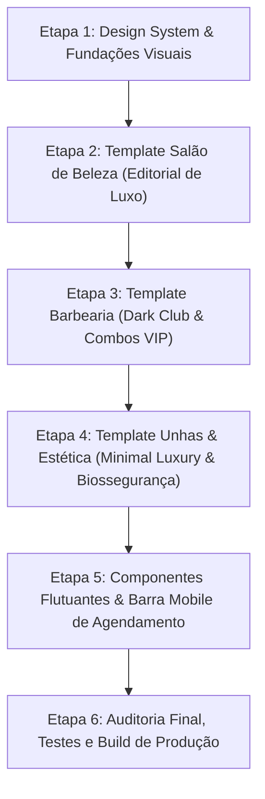

# Auditoria Visual & Arquitetural dos Templates Públicos do GlowSaaS

**Data da Auditoria:** 29 de Outubro de 2026  
**Escopo:** Exclusivamente os 3 templates públicos (`/p/[slug]`):
- **Salão de Beleza** (`lumiere-hair` / `SalonTemplate`)
- **Barbearia** (`navalha-de-ouro` / `BarberTemplate`)
- **Unhas & Estética** (`gisele-nails` / `NailsTemplate`)
**Documentos de Apoio:**
- `src/app/(public-sites)/p/[slug]/page.tsx`
- `src/components/templates/salon/*` (11 arquivos)
- `src/components/templates/barber/*` (12 arquivos)
- `src/components/templates/nails/*` (11 arquivos)
- `src/components/editor/EditorTabs.tsx`
- `src/types/database.ts` e `src/types/landing-page.ts`
- `src/lib/supabase/data-service.ts`

---

## 1. Resumo Executivo & Diagnóstico Geral

Os templates públicos do GlowSaaS foram construídos com uma base técnica sólida (Next.js App Router, SSR limpo, formatação BRL rigorosa e sanitização de URLs do WhatsApp). No entanto, do ponto de vista **visual, comercial e de posicionamento de marca**, os templates atuais apresentam uma estética de **"layout clonado por blocos"** (*cookie-cutter design*).

Embora cada segmento utilize uma paleta de cores própria (bege para salão, grafite/âmbar para barbearia e rosé para unhas), **a estrutura visual dos três é rigorosamente idêntica**:
- O mesmo grid 7/5 no Hero com uma caixinha de foto estática e um cardzinho flutuante no canto inferior esquerdo.
- Os mesmos 4 cartões de diferenciais lado a lado.
- A mesma grade de serviços com abas de categoria no topo e botão "Agendar" tímido.
- A mesma galeria retangular 3x2 com gradiente inferior escuro.
- O mesmo bloco de equipe com avatares circulares de 64x64px (estilo diretório corporativo/SaaS, distante da estética de estúdios e salões renomados).
- A mesma tabela rígida de horários dividida 50/50 com o endereço.
- O mesmo banner final escuro e um botão flutuante de WhatsApp padrão.

### Diagnóstico de Impacto:
O cliente de um salão de alto padrão, barbearia club ou nail designer busca **encantamento visual, sofisticação e segurança técnica**. Os templates atuais transmitem uma impressão de página funcional básica, mas **não despertam o desejo imediato de contratação** que um trabalho de agência premium de alta conversão entrega.

---

## 2. Análise Transversal: Elementos Genéricos, Básicos ou Repetidos

| Elemento / Seção | Problema Encontrado | Por que Parece Básico / Template Repetido |
| :--- | :--- | :--- |
| **Hero Section** | Estrutura 7/5 idêntica nos 3 templates. Imagem confinada a um container `aspect-[4/5]` pequeno com uma bordinha decorativa rotacionada. | Falta presença fotográfica imersiva. Em agências de design, o hero de beleza é editorial, com tipografia imponente, sobreposições elegantes ou layout assimétrico de alta moda. |
| **Apresentação de Serviços** | Cards de serviços idênticos: badge de categoria, duração, título, descrição e botão "Agendar" cinza claro. | Não valoriza "procedimentos assinatura" (*Signature Treatments*). Em salões de luxo, tratamentos como Mechas Criativas ou Combos VIP merecem destaque visual consagrado e hierarquia diferenciada. |
| **Equipe & Especialistas** | Avatares minúsculos de 64x64px dentro de cartões brancos com borda fina. | Parece lista de funcionários de helpdesk. Especialistas em beleza, visagistas e barbeiros vendem imagem, estilo e autoridade. Precisam de fotografias verticais expressivas de corpo ou busto. |
| **Galeria de Fotos** | Grid repetitivo 3x2 com proporção idêntica em todas as fotos e legenda sobreposta em gradiente preto. | Falta dinamismo visual (masonry elegante, formatos editoriais alternados, foco em texturas de cabelo, navalha ou nail art em close macro). |
| **Diferenciais / Benefícios** | 4 caixas idênticas com ícone em caixinha arredondada no topo. | Padrão genérico de landing page de software (SaaS B2B), pouco conectado ao ritual sensorial da beleza. |
| **Horários & Localização** | Tabela fria de dias da semana (linhas zebradas) e bloco de endereço com botões comuns. | Transmite burocracia em vez de acolhimento e exclusividade de atendimento com hora marcada. |
| **Chamada Final (CTA)** | Faixa escura com texto centralizado e botão largo. | Muito comum e desprovida de identidade estética setorial. |
| **Botão de WhatsApp** | Botão circular flutuante verde genérico no canto inferior direito. | Em mobile, disputa espaço com o rodapé e pode cobrir informações cruciais. Falta uma barra de ação mobile ergonômica (*Sticky Mobile Booking Bar*). |

---

## 3. Diagnóstico Individual por Template

---

### A. Template Salão de Beleza (`SalonTemplate` — ex: `Lumière Concept`)

*Identidade Atual:* Bege/Creme (`#FAF8F5`), Dourado Nude (`#A9855E`), Bordas (`#EAE3D9`).

#### Problemas Encontrados:
1. **Falta de Atmosfera Editorial:** Salões premium (estilo Jardins, Leblon, Soho) comunicam luxo silencioso (*quiet luxury*). O template atual usa bege claro, mas os cards parecem caixas soltas sem fluidez visual de revista de moda.
2. **Fotografia Sem Destaque de Transformação:** A galeria não transmite a dramaticidade de um "Loiro Perolado" ou "Morena Iluminada". As imagens pequenas perdem o brilho e o acabamento dos cabelos.
3. **Menu de Procedimentos sem Glamour:** Valores como R$ 480,00 para mechas precisam de uma apresentação que justifique o valor agregado (detalhamento do ritual, produtos importados utilizados, etapas do serviço).
4. **Equipe com Miniaturas:** Coloristas e cabeleireiros renomados são os maiores embaixadores do salão. As miniaturas de 64px diminuem a percepção de autoridade.

#### Direção Visual Recomendada (Agência / Editorial):
- **Estilo:** *Vogue / Harper's Bazaar meets Luxury Wellness*.
- **Cores & Texturas:** Tons champagne e linho natural (`#FAF7F2`, `#F5EFEB`), linhas ultrafinas em bronze antigo (`#C2A37E`, `#8C6A47`), tipografia Playfair Display refinada com tracking editorial largo.
- **Hero:** Composição assimétrica imponente, fotografia editorial ampla, tipografia de revista de alta costura com badge minimalista.
- **Menu de Serviços:** Divisores refinados com tipografia serifada para procedimentos de destaque ("Assinatura Lumière") e cartões fluidos com espaçamento generoso.
- **Galeria:** Layout assimétrico tipo editorial com alternância de retratos e fotos de detalhes/ambiente.
- **Equipe:** Retratos elegantes de três quartos com biografia de especialidade e destaque para cursos e certificados.

---

### B. Template Barbearia (`BarberTemplate` — ex: `Navalha de Ouro`)

*Identidade Atual:* Grafite Escuro (`#121212`, `#141414`), Âmbar/Ouro Envelhecido (`#C5A059`), Bordas (`stone-800`).

#### Problemas Encontrados:
1. **Tema Escuro sem Profundidade:** O fundo escuro é chapado (`#121212`), sem texturas que remetam ao couro envelhecido, lâminas de barbear, tabaco, tijolo aparente ou madeira nobre.
2. **Combos VIP Pouco Destacados:** O componente `BarberFeaturedCombos` existe, mas seu visual é quase igual ao de serviços normais, apenas com uma borda amarela. Não transmite a sensação de um "Clube Exclusivo".
3. **Falta de "Pegada" Masculina Moderna:** O layout é contido demais. Falta um design com cortes geométricos chanfrados, tipografia de impacto com peso marcante (*uppercase* robusto e serifas tradicionais estilo clube londrino ou barbearia industrial nova-iorquina).
4. **Agendamento com Pouca Urgência:** Barbearias dependem de giro rápido de agenda ("Sem Fila", "Chopp Gelado na Espera"). Os botões parecem tímidos.

#### Direção Visual Recomendada (Marcante & Profissional):
- **Estilo:** *Speakeasy Barber Club / Industrial Premium*.
- **Cores & Texturas:** Fundo grafite profundo com nuances carvão (`#0D0D0D`, `#171717`), detalhes em âmbar/dourado acetinado (`#C5A059`), bordas em metal escovado escuro (`#2A2A2A`).
- **Hero:** Imagem com tratamento de alto contraste e iluminação direcionada (luz e sombra marcantes), tipografia sólida com personalidade tradicional/vintage moderna.
- **Combos VIP:** Cartões estruturados como "Menus de Clube", com lista de rituais inclusos (toalha quente, navalha descartável, cerveja cortesia) e selo destacado.
- **Serviços:** Organização dinâmica com distinção visual clara entre Cortes, Barba e Tratamentos Capilares.
- **Galeria:** Foco em linhas perfeitas de degradê (fade), barbas alinhadas e ambiente acolhedor.
- **Equipe (Mestres Barbeiros):** Fotos em preto e branco sofisticadas com hover colorido, revelando a especialidade de cada barbeiro.

---

### C. Template Unhas & Estética (`NailsTemplate` — ex: `Studio Gisele Nails`)

*Identidade Atual:* Off-white rosado (`#FCFAF9`), Rosé/Terracota (`#B75B4A`), Bordas suaves (`#F2EAE7`).

#### Problemas Encontrados:
1. **Excesso de Delicadeza sem Autoridade Técnica:** O template passa uma ideia de delicadeza, mas deixa de comunicar a **precisão cirúrgica, biossegurança e resistência** das unhas em gel e fibra.
2. **Macrofotografia Ausente:** Nail design é uma arte milimétrica de detalhes (cuticulagem russa, nivelamento de gel, curvatura C, francesinha reversa). A galeria atual usa fotos genéricas sem destacar o macro da curvatura e da simetria.
3. **Serviços sem Informação de Durabilidade:** As clientes de nail design decidem pelo tempo de manutenção (20 a 30 dias) e pelo tipo de técnica (Gel moldado x Fibra de vidro x Blindagem). O layout trata todos os serviços igualmente.
4. **Falta de Apelo "Instagrammável":** Este é o nicho mais visual e viral das redes sociais. A página precisa parecer um feed de estética limpa e luxuosa (*Clean Aesthetic / Pinterest Chic*).

#### Direção Visual Recomendada (Refinado, Delicado & Moderno):
- **Estilo:** *Clean Girl Aesthetic / Minimal Luxury Nail Studio*.
- **Cores & Texturas:** Off-white acetinado (`#FDFBF9`), toques de rosé nude suave (`#FAF0ED`, `#F5DDD7`), tipografia clássica elegante com contraste suave e detalhes em terracota sofisticado (`#B75B4A`).
- **Hero:** Fotografia com foco na perfeição das mãos e unhas, iluminação suave e limpa, layout arejado com badge de biossegurança de destaque.
- **Serviços:** Cartões com pílulas visuais de durabilidade ("Dura até 30 dias"), técnica utilizada ("Fibra de Vidro") e indicação de manutenção.
- **Galeria (Feed Estético):** Grade estilo portfólio de alta definição, destacando formatos (Almond, Stiletto, Quadrada) e detalhes de nail art minimalista.
- **Biossegurança em Destaque:** Selo visual de esterilização em autoclave com ícones limpos, transmitindo segurança médica/sanitária.

---

## 4. Mapeamento Arquitetural: O que Já é Editável vs. O que é Fixo

Para que o plano de redesign seja 100% seguro e não quebre a integração com o painel do cliente (`/app/editor`), mapeamos a origem de cada dado:

### ✅ Conteúdos Dinâmicos (Editáveis no Painel pelo Tenant):
1. **Identidade Básica:** Nome comercial (`tenant.business_name`), Slug (`tenant.slug`), Segmento (`tenant.segment`).
2. **Cores:** Cor Primária (`page.theme_config.primary_color`) e Secundária (`page.theme_config.accent_color`).
3. **Contato:** WhatsApp de agendamento (`contact.whatsapp_number`), Instagram (`contact.instagram_handle`).
4. **Hero Topo:** Selo/Badge (`hero.badge`), Headline (`hero.headline`), Subheadline (`hero.subheadline`), Texto do botão (`hero.cta_text`), URL da foto principal (`hero.hero_image_url`).
5. **Procedimentos & Serviços:** Nome, Categoria, Preço (R$), Duração estimada (minutos), Descrição.
6. **Galeria:** Adição e remoção de imagens (URL + Título da foto).
7. **Sobre o Espaço:** Título da seção (`about.title`), Descrição da filosofia (`about.description`), Anos de experiência (`about.years_experience`).
8. **Endereço:** Rua e número, Bairro, Cidade/UF.

### ⚠️ Conteúdos Atualmente Fixos no Código (Fallback no DB, Sem UI de Edição no Painel):
1. **Diferenciais / Benefícios:** Utilizam `page.differentials` se existirem no banco, mas o `EditorTabs` **não possui formulário para o cliente editar**. Caem no `defaultDifferentials` de cada template.
2. **Equipe / Profissionais:** Utilizam `page.team` se existirem no banco, mas o `EditorTabs` **não possui formulário para adicionar/editar membros**. Caem no `defaultTeam` de cada template.
3. **Foto de Destaque da Seção Sobre:** Utiliza `about.highlight_image_url`, mas a Aba 5 do editor não tem campo para alterar essa URL.
4. **Horários de Funcionamento Detalhados:** A tabela recebe `business_hours` do banco, mas o editor atual não possui interface para alterar horários de cada dia da semana.
5. **Mensagem Padrão do WhatsApp:** `contact.whatsapp_default_message` está salva no banco, mas não é exposta para edição direta no formulário do editor.

> [!IMPORTANT]
> **Implicação Direta para o Redesign:**  
> O redesign visual dos templates deve respeitar rigorosamente os dados reais fornecidos pelas interfaces TypeScript (`PublicLandingPageData`), aproveitando ao máximo os campos dinâmicos existentes e tratando os fallbacks estáticos com altíssimo padrão estético, sem exigir novas colunas no banco de dados nem quebrar a compatibilidade com o editor.

---

## 5. Mapeamento Completo de Arquivos Envolvidos

```
src/components/templates/
├── salon/
│   ├── index.tsx                     # Orquestrador do Salão
│   ├── SalonHeader.tsx               # Header e Menu Mobile
│   ├── SalonHero.tsx                 # Dobra Principal e CTA
│   ├── SalonBenefits.tsx             # 4 Pilares de Diferenciais
│   ├── SalonServices.tsx             # Menu de Procedimentos
│   ├── SalonGallery.tsx              # Portfólio de Transformações
│   ├── SalonAbout.tsx                # Sobre e Equipe de Especialistas
│   ├── SalonHoursAndLocation.tsx     # Horários e Google Maps
│   ├── SalonFinalCTA.tsx             # Chamada Final para WhatsApp
│   ├── SalonFooter.tsx               # Rodapé
│   └── SalonFloatingWhatsApp.tsx     # Botão Flutuante
├── barber/
│   ├── index.tsx                     # Orquestrador da Barbearia
│   ├── BarberHeader.tsx              # Header e Menu Mobile
│   ├── BarberHero.tsx                # Dobra Principal de Impacto
│   ├── BarberBenefits.tsx            # Diferenciais da Barbearia
│   ├── BarberFeaturedCombos.tsx      # Combos VIP em Destaque
│   ├── BarberServices.tsx            # Tabela de Cortes e Barba
│   ├── BarberGallery.tsx             # Portfólio de Cortes e Estilo
│   ├── BarberTeam.tsx                # Mestres Barbeiros
│   ├── BarberHoursAndLocation.tsx    # Horários e Localização
│   ├── BarberFinalCTA.tsx            # Chamada Final
│   ├── BarberFooter.tsx              # Rodapé
│   └── BarberFloatingWhatsApp.tsx    # WhatsApp Flutuante
└── nails/
    ├── index.tsx                     # Orquestrador de Nails
    ├── NailsHeader.tsx               # Header e Menu Mobile
    ├── NailsHero.tsx                 # Dobra Principal Delicada
    ├── NailsBenefits.tsx             # Diferenciais e Biossegurança
    ├── NailsServices.tsx             # Menu de Alongamentos e Cuidados
    ├── NailsGallery.tsx              # Galeria de Formatos e Detalhes
    ├── NailsAbout.tsx                # Sobre a Nail Designer
    ├── NailsHoursAndLocation.tsx     # Horários e Localização
    ├── NailsFinalCTA.tsx             # Chamada Final
    ├── NailsFooter.tsx               # Rodapé
    └── NailsFloatingWhatsApp.tsx     # WhatsApp Flutuante
```

Arquivos de Suporte e Infraestrutura (Apenas leitura/preservação):
- `src/app/(public-sites)/p/[slug]/page.tsx` (Roteamento público)
- `src/lib/supabase/data-service.ts` (`getPublicPageBySlug` e dados demo)
- `src/types/database.ts` e `src/types/landing-page.ts` (Contratos de dados)
- `src/lib/utils.ts` (`formatWhatsAppUrl`, `formatCurrency`)
- `tests/verify-phase3-salon.mjs`
- `tests/verify-phase4-barber.mjs`
- `tests/verify-phase5-nails.mjs`

---

## 6. Plano de Redesign em Etapas Seguras

Para garantir a estabilidade do sistema, conformidade com os testes existentes e aprovação visual a cada passo, a reformulação deve ser dividida em **etapas independentes**:



### Etapa 1: Design System & Fundações Visuais dos Templates
- Padronizar tokens de design no Tailwind para cada nicho (sombras sofisticadas, bordas acetinadas, efeitos de blur sutis).
- Refinar hierarquia tipográfica no `globals.css` sem quebrar o uso já estabelecido na landing page principal.
- Preservar rigorosamente os IDs das seções (`#topo`, `#servicos`, `#diferenciais`, `#galeria`, `#sobre`, `#localizacao`) para manter os menus e âncoras funcionando.

### Etapa 2: Reformulação do Template de Salão de Beleza (`SalonTemplate`)
- **Hero:** Layout assimétrico editorial com tipografia de revista de alta moda, fotografia principal de grande escala e microdestaques de conforto.
- **Serviços:** Cartões elegantes com separadores refinados, indicação de procedimento assinatura e valores destacados em tipografia serifada.
- **Galeria:** Composição visual diversificada para cortes, mechas e ambiente.
- **Equipe:** Cards verticais de especialistas com retratos expressivos e especialidades.
- **Validação:** Rodar `tests/verify-phase3-salon.mjs`, `npx tsc --noEmit` e checar visualmente.

### Etapa 3: Reformulação do Template de Barbearia (`BarberTemplate`)
- **Hero:** Atmosfera escura de alto contraste com tons grafite escovado e detalhes em âmbar clássico (`#C5A059`).
- **Combos VIP:** Cartões estilizados como menus de confraria tradicional com selos de experiência completa.
- **Serviços:** Grid robusto e limpo de cortes individuais e barboterapia.
- **Galeria:** Foco em degradês e técnicas de navalha afiada.
- **Equipe:** Barbeiros em fotos verticais de ateliê.
- **Validação:** Rodar `tests/verify-phase4-barber.mjs`, `npx tsc --noEmit` e checar visualmente.

### Etapa 4: Reformulação do Template de Unhas & Estética (`NailsTemplate`)
- **Hero:** Design *Clean Aesthetic* com fotografia de grande presença visual, tons rosé nude (`#FCFAF9`, `#B75B4A`) e badge de biossegurança de alto valor.
- **Serviços:** Pílulas visuais de técnica (Gel moldado, Fibra, Blindagem) e durabilidade estimada.
- **Galeria:** Foco em macrofotografia e acabamento milimétrico.
- **Biossegurança & Especialistas:** Destaque para autoclave cirúrgica e protocolos de saúde ungueal.
- **Validação:** Rodar `tests/verify-phase5-nails.mjs`, `npx tsc --noEmit` e checar visualmente.

### Etapa 5: Otimização Mobile & Experiência de Agendamento
- Introduzir uma barra de ação ergonômica para celular (*Sticky Mobile Booking Bar*) que acompanha a rolagem sem cobrir o conteúdo, além de manter o botão flutuante para desktop.
- Garantir que toda mensagem de WhatsApp gerada mantenha o formato exigido pelos testes (`formatWhatsAppUrl`).
- Prevenir qualquer overflow horizontal em telas a partir de 360px.

### Etapa 6: Verificação de Integridade & Conclusão
- Executar a suíte completa de testes (`node --test tests/*.mjs`).
- Executar compilação estrita de TypeScript (`npx tsc --noEmit`).
- Executar build de produção Next.js (`npm run build`).
- Gerar relatório final de entrega.

---

## 7. Garantias de Segurança & Não-Interferência

Nesta auditoria e no plano proposto:
- [x] **Zero código alterado durante esta fase.**
- [x] **Nenhuma modificação em autenticação, Supabase, RLS, banco de dados ou planos.**
- [x] **Compatibilidade total com o Editor do Cliente (`/app/editor`) preservada.**
- [x] **Rotas públicas mantidas rigorosamente em `/p/[slug]`.**
- [x] **Regras de isolamento de clientes suspensos ou em rascunho intactas.**
- [x] **Sem criação de funcionalidades fictícias.**

